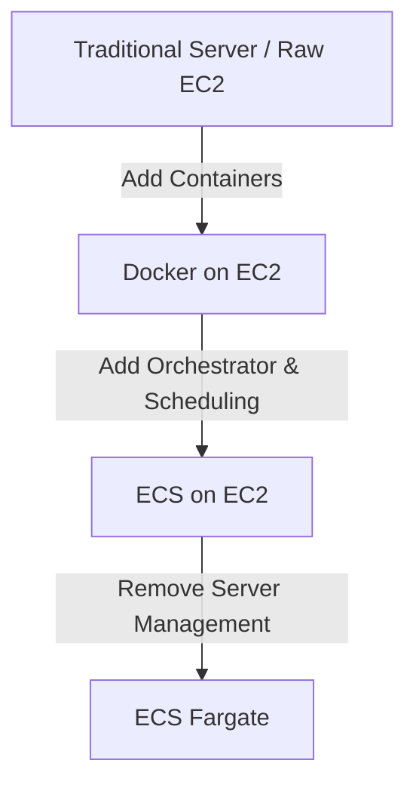

> **TL;DR:** A quick look at why teams evolve from managing traditional virtual machines or servers to container orchestrators, and the operational trade-offs you encounter at every step of the abstraction ladder.

---

## 1. The Context & The Problem

- **Old way**: Deploying the applications on servers hosted in own data center.
- **The Bottleneck**: Incurs significant Capex; Patching, Updates, Upgrades, Server Uptime, Manual Scaling, Security should be managed manually.

---

## 2. The compute abstraction ladder

---

## 3. Available options to host the application

Here is a technical overview breaking down what you manage versus what AWS manages across each hosting layer, along with distinct advantages, disadvantages and tradeoffs.

### Available options

| Sl No | Options |
| ----- | ------- |
| 1.    | [Raw Server](#traditional-server-virtual-machine-on-prem) |
| 2.    | EC2   |
| 3.    | Docker on EC2 |
| 4.    | Docker + ECS on EC2    |
| 5.    | Docker + ECS on Fargate (serverless) |

### Traditional Server, Virtual Machine (On-prem)

**What you manage**: Physical hardware, data center space, power & cooling, OS installation, network switches, OS patching, security, uptime, app uptime, manual scaling.

**What is managed for you**: Nothing.

| Advantage | Disadvantage |
| --------- | ------------ |
| Absolute control over physical and virutal layers of the machine. | High upfront cost (CAPEX). |
| Data resides in your own data center. | Hardware maintenance (disk failures, power issues, server issues). |
| | Scaling manually will be slow and difficult (You need to buy new servers or increase existing server configuration). |
---
