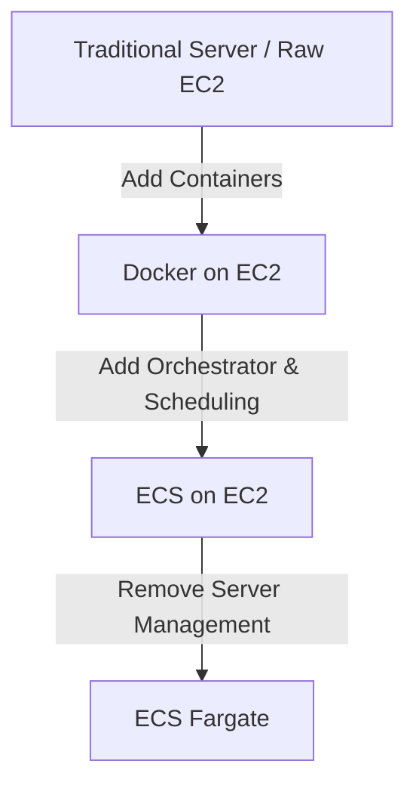

> **TL;DR:** A quick look at why teams evolve from managing traditional virtual machines or servers to container orchestrators, and the operational trade-offs you encounter at every step of the abstraction ladder.

---

## 1. The Context & The Problem

- **Old way**: Deploying the applications on servers hosted in own data center.
- **The Bottleneck**: Incurs significant Capex; Patching, Updates, Upgrades, Server Uptime, Manual Scaling, Security should be managed manually.

---

## 2. The compute abstraction ladder

---

## 3. Available options to host the application

Here is a technical overview breaking down what you manage versus what AWS manages across each hosting layer, along with distinct advantages, disadvantages and tradeoffs.

### Available options

| Sl No | Options |
| ----- | ------- |
| 1.    | [Raw Server](#traditional-server-virtual-machine-on-prem) |
| 2.    | [EC2](#ec2amazon-elastic-compute-cloud)   |
| 3.    | [Docker on EC2](#docker-on-ec2) |
| 4.    | [Docker + ECS on EC2](#docker--ecs-on-ec2)    |
| 5.    | [Docker + ECS on Fargate (serverless) ](#docker--ecs-on-fargate-serverless) |

### Traditional Server, Virtual Machine (On-prem)

**What you manage**: Physical hardware, data center space, power & cooling, OS installation, network switches, OS patching, security, uptime, app uptime, manual scaling.

**What is managed for you**: Nothing.

| Advantage | Disadvantage |
| --------- | ------------ |
| Absolute control over physical and virutal layers of the machine. | High upfront cost (CAPEX). |
| Data resides in your own data center. | Hardware maintenance (disk failures, power issues, server issues). |
| - | Scaling manually will be slow and difficult (You need to buy new servers or increase existing server configuration). |

### EC2(Amazon Elastic Compute Cloud)

**What you manage**: OS (installation, patches, updates, hardening), network configurations (VPC, Subnets, Security Groups), app runtime/dependencies, app uptime, scaling.

**What is managed for you**: Physical data centers, physical network infrastructure, server hardware.

| Advantage | Disadvantage |
| --------- | ------------ |
| No hardware to buy or maintain. Can spin up the server in minutes. | Should manage OS installation, patches, updates. |
| Can change the instance type as your requirements change. | Should configure Auto Scaling and Application Load Balancers. |

### Docker on EC2

**What you manage**: Docker runtime environment, image/container configuration, OS lifecycle, container orchestration, scaling.

**What is managed for you**: Physical data centers, physical network infrastructure, server hardware.

| Advantage | Disadvantage |
| --------- | ------------ |
| Solves *It runs on my machine, so it works on server* problem. | Combines the management of EC2 with container orchestration, scaling. |
| | Manual port mapping b/w host and container. Allotment of resources are manual. |

### Docker + ECS on EC2

**What you manage**: EC2 (OS lifecycle, cluster scaling), Defining task definitions, cluster networking.

**What is managed for you**: Container orchestration (placement of containers, restarting containers on crash), task scaling, load lalaner integration.

| Advantage | Disadvantage |
| --------- | ------------ |
| Automated container recovery, rolling deployments by ECS. | Should still manage the clusters. New tasks cannot be added if cluster capacity is full. |
| Efficient resource packing (can pack multiple tasks in a server). | |

### Docker + ECS on Fargate (serverless)

**What you manage**: Application code, Docker container images, Task Definitions.

**What is managed for you**: Everything else will be managed by AWS. It includes OS lifecycle, cluster scaling, infrastrucre security, etc.

| Advantage | Disadvantage |
| --------- | ------------ |
| Zero Server Management. | Less low-level access (cannot SSH into the server to debug issues). |
| Good for unpredictable workloads. | |
---

## Final Note

The respective *log* depicts the evolution of hosting the *app* on the server in the on-premises datacenter to *Docker + ECS on Fargate*.

Every choice comes with its own set of advantages and disadvantages. One should choose the right solution based on their requirements.

Hope you find this meaningful,\
Thank you 🙂...

---