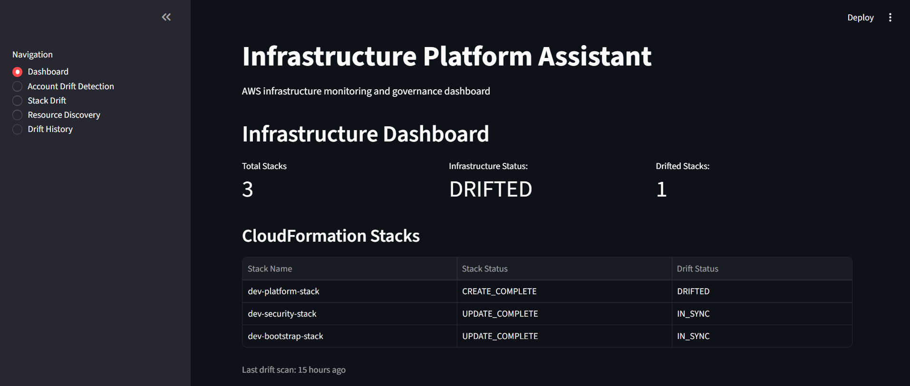
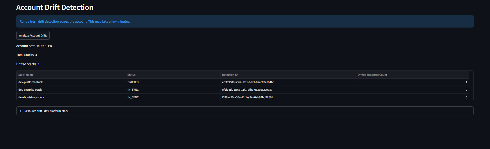
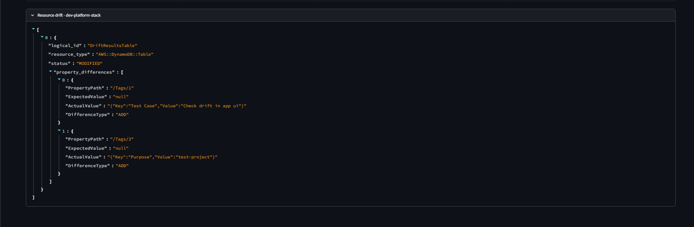
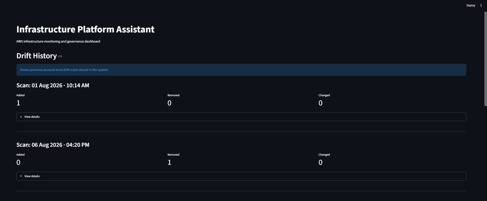
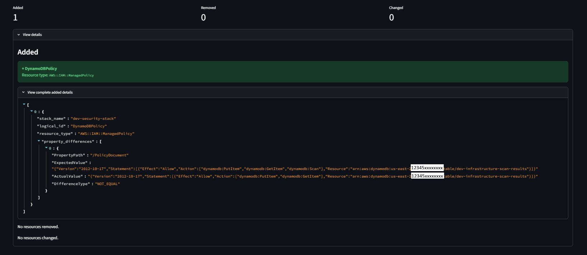
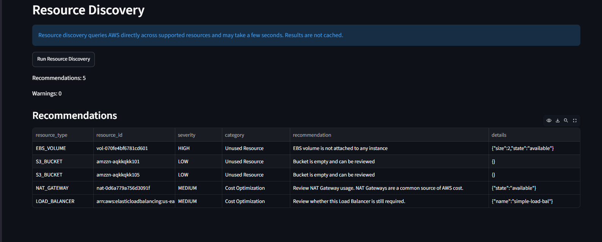
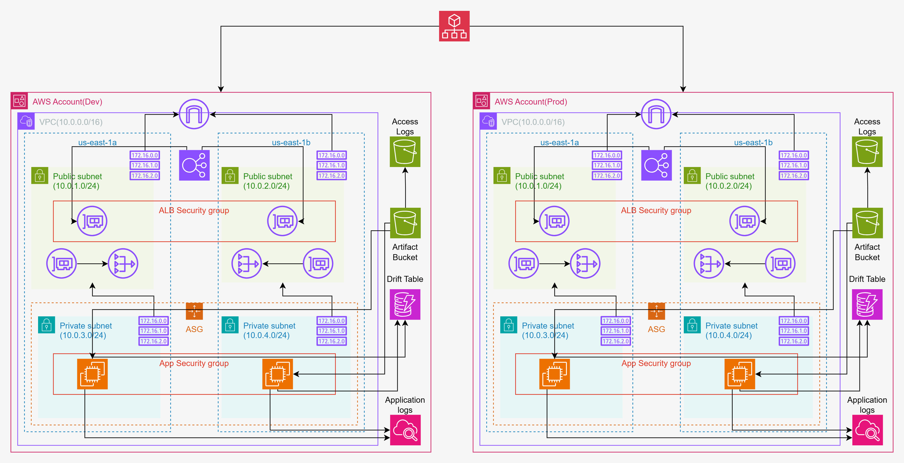
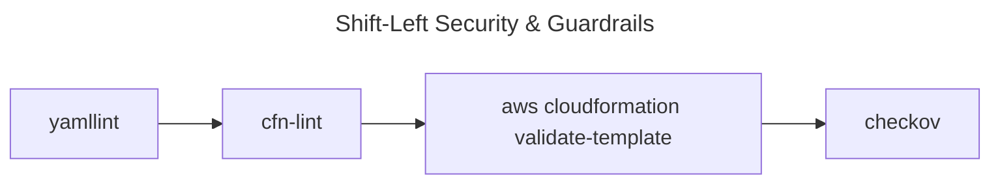

> **TL;DR:** An engineering deep dive into personal portfolio project: *AWS Infra Governance Assistant* including key capabilities, design choices, limitations and possible enhancements.

---
<br>


_Figure 1: AWS Infrastructure Governance Assistant Dashboard._
{: .text-center }

<br>

## Background & Motivation

### Problem 1

- In modern engineering environments the infrastructure is provisioned using the principle of **IAC** (Infrastructure As Code) which provides declarative capabilities to define, create, modify, and destroy the infra.

- When an organization provisions infra using **IAC** there is a possibility of accidental (manual) modifications to the maintained, provisioned infra.

- Whenever the infra is modified manually, the desired state will not match with the current state, which in turn is referred as *Drift*.

- **DevOps Team**, **Infra Team**, **Platform Team**, **Developers Team** need a way to detect this in a simple way rather than invoking custom commands or scripts or going to each stack in the UI and perform detect drift check (specifically for AWS CloudFormation Stacks).

- Now what if they have 20-30 stacks?

- Going to each stack and checking the drifts is time consuming, complex. Also there is a possibility that one might forget to check few stacks in between when there exists 20-30 stacks which can have significant consequence.

### Solution

- **AWS Infra Governance Assistant** solves this by providing a clean way to check infra drifts across your workloads through a **simple dashboard**.It not only provides *Drift Detection* at the **stack level** but at the **account level**.

- One can view each drift with the property differences across every stack in that account just by the click of the button in a single dashboard.

- Currently the drifts are detected for *AWS CloudFormation* workloads.

### Question

> If one can directly check drifts using *AWS Console*,*AWS CLI*, why do we even need a duplicate solution?

### Current Method

We have the options to detect resource drifts at a **stack level** without any cost, custom deployment complexities.

One can go to the *AWS Console*, click on a specific stack and click the detect drift to check the drift at the **stack level**.

Also to give you a simple overview, if one prefers drift detection through *AWS CLI* everytime they need to run:

**Step 1: Start a detection job**

```bash
aws cloudformation detect-stack-drift --stack-name <stack-name>
```

**Step 2: Monitor progress**

```bash
aws cloudformation describe-stack-drift-detection-status --stack-drift-detection-id <id>
```

**Step 3: Detect property differences**

```bash
aws cloudformation describe-stack-resource-drifts --stack-name <stack-name>
```

> Note: One should execute this every time per stack to detect the stack drifts.

### Enhancement being provided

However the project is not only providing the *Drift Detection* capabilities which is already provided by *AWS Console*, but it provides *Drift Detection* at the **entire account level** (not at the **stack level**).

Without this one might want to write custom scripts, manually go to the stack, click on the detect drift option which can be time consuming as an organization can manage 100s of stacks.

> A sample illustration:
<br>


_Figure 2: Account Drift Snapshot._
{: .text-center }

<br>


_Figure 3: Stack Drift Details._
{: .text-center }

<br>

### Problem 2

- What if along with current *Drift Details*, the team requires the historical details?

- How many *Drifts* are being *added*, *removed*, *changed* each day since past 'n' days? Or per say need historical *Drift* details including:
    - *added*, *what drifts are added compared to previous drift detection scan*
    - *removed*, *what drifts are removed compared to previous drift detection scan*
    - *changed*, *what drifts are modified compared to previous drift detection scan*

### Solution

The project contains **Drift History** page which provides these capabilities so that one can easily check their infra healhy history.

> A sample illustration:
<br>


_Figure 3: Drift History._
{: .text-center }

<br>


_Figure 4: Added, Removed, Changed Drifts._
{: .text-center }

<br>

### Problem 3

- In organizations **idle resources** are one of the biggest issues as they can increase the cloud bills by significant amount.

- What if the organization have idle *Servers, EIPs, EBS volumes* but are not aware of them?

- What if they have many **NAT Gateways, Load Balancers** among which few of them are not needed?

### Solution

- The project provides a simple dashboard providing the information about:
    1. Unused Resource: EC2, EIPs, EBS volumes
    2. Cost Optimization: NAT Gateways, Load Balancers

- Here the thing to remeber is currently the *Cost Optimization* category represents resource which are not necessarily idle but their presence itself can have huge imapact. So need a way to just list each and every resource (NAT,ELBs), provide warning regarding them.

> A sample illustration:

<br>


_Figure 5: Resource Discovery Dashboard._
{: .text-center }

<br>

## Architecture, Design Decisions


_Figure 6: Platform Architecture._
{: .text-center }

### 1. OIDC over long term keys

*Open ID Connect* is used for authentication and authorization over traditional *access keys & secret keys*.

No need to store any *creds* in the repo.

No need to manually rotate the *creds*.

*sts* generates short term creds which reduces the *blast radius* in an event of compromise(very rare).

To top that one can enforce granular trust policy by adding which repo, which environment, which event, which branch is allowed to perform the actions specified in the permissions policy.

### 2. High Availability Architecture

1. Multi-AZ
    - Platform is deployed across 2 *AZ*: *us-east-1a*, *us-east-1b*.
    - Any issue to one data center will not affect another, providing HA.
2. HA NAT
    - 2 NATs are deployed (1 per AZ).
    - If any of the *AZ* goes down, if any of the NAT faces an issue, servers in another *AZ* can still make outbound calls.
    - *Eliminates Cross-AZ Data Transfer Fees* which AWS charges for requests made by servers from another *AZ* which would occur if only 1 NAT exist.
    - *Eliminates Cross-AZ Network Latency* which would happen if there was only 1 NAT Gateway as the packets would travel to another AZ and then to the internet gateway.
3. ELB
    - Distributes the traffic across multiple servers across 2 AZ.

4. ASG
    - Provides auto scaling capabilities across AZ to maintain the performance and traffic spikes.

### 3. Use of `iam:PassRole`

*GitHub Actions* will pass the appropriate role (rather than directly being the executor) to the service: `cloudformation.amazonaws.com`.

This will prevent any attacks that can happen otherwise(broad permissions provided directly to the pipleine itself).

### 4. Hosting the platform in private subnet

Platform is deployed on private subnet.

Inbound : ALB Security Group

Outbound: NAT gateway

This will protect the platform as it is not visible over public network and still can make outbound calls like *pulling an application artifact* from S3 or *storing the drift data* to a DynamoDB table through NAT Gateway.

### 5. Shift-Left Security & Guardrails

Every new PR to infra will go through linting, validation, custom policy checks.

Flow would be:



Custom policies & rationale behind their implementation:

- **Rule01:** Enforces a strict retention period of exactly 30 days for all CloudWatch Log Groups.
    - **Business & Technical Rationale:**
        - **Operational Visibility:** 30 days provides an optimal window to debug application errors, system anomalies, or `cloud-init` boot failures.
        - **FinOps Optimization:** AWS defaults log retention to "Never Expire," leading to silent, compounding storage costs over time. Standardizing on 30 days eliminates dead storage while keeping logs long enough to be shipped to a cold storage data lake if needed for long-term compliance.

- **Rule02:** Restricts block device configurations in Launch Templates to `gp3` only, blocking legacy `gp2` or magnetic volumes.
    - **Business & Technical Rationale:**
      - **Cost Efficiency:** `gp3` volumes offer a baseline 20% lower price per GB per month compared to `gp2`.
      - **Architectural Decoupling:** Unlike `gp2`, where IOPS and throughput are tied directly to the size of the volume (forcing over-provisioning), `gp3` allows us to scale IOPS and throughput independently of storage capacity. Every volume starts with a free baseline of 3,000 IOPS and 125 MB/s.

- **Rule03:** Enforces the presence of four mandatory keys on all taggable resources: `Environment`, `Project`, `Owner`, and `ManagedBy`.
    - **Business & Technical Rationale:**
      - **FinOps Accountability:** Essential for accurate cost allocation, budget alerting, and generating granular AWS Cost Explorer reports.

### 6. EC2 over ECS, EKS

Platform hosting options: AWS EC2, AWS ECS, AWS EKS

Choose EC2 over the other 2.

EC2 provides more granular control compared to the other choices.

But then it also adds lot of overhead as you will become responsible for OS security, OS patching, Scaling (with ASG), Maintaining consistent runtimes.

More granular control over OS, the overall application footprint / traffic (low as of now), need for understanding the helper scripts per say `cfn-init`, `cfn-signal` under the hood, curiosity to explore *Golden Images* were few reasons in choosing the *AWS EC2*.

One can absolutely go with *AWS ECS (on EC2)*, *AWS ECS (Fargate)*, *AWS EKS* as per their requirement.

### 7. Consistent server provisioning through **golden images**

The servers are provisioned consistently through pre-approved **golden AMIs**.

Some benfits include:

- **Faster boot times during a scale-out event:** By baking runtime directly into an image.
- **Higher deployment reliability:** No need to check the availability of upstream servers or remote package repos during boot.
- **Elimination of configuration drift:** Every EC2 instance spun up from a specific golden AMI ID is bit-for-bit identical. You avoid scenarios where two instances in the same target group end up with slightly different dependency versions because a package updated upstream between launches.
- **Predictable Rollbacks:** If a new deployment introduces a bug, rolling back in AWS simply means updating your EC2 Launch Template to point back to the previous golden AMI ID and triggering an Instance Refresh.

Golden image configurations:

- Tool            : HashiCorp Packer

- Base AMI        : `al2023-ami-minimal-2023.*-kernel-*-x86_64`

- Root Device Type: EBS volumes

- Runtime packages:

    - aws-cfn-bootstrap
    - amazon-ssm-agent 
    - amazon-cloudwatch-agent
    - python3.13
    - unzip

### 8. cfn-init with UserData over putting everything into UserData

Whenever servers are provisioned to host the application workloads, normally certain bash commands are executed through *UserData* or *Ansible* commands are invoked during boot to install packages, configure runtime, security components.

However *bash commands or scripts* are **imperative** in nature.

*cfn-init* provides declarative capabilities through `AWS::CloudFormation::Init` metadata block.

One can easily organize the requirements into `packages`, `files`, `commands`, `services` block.

One can pair this with *Userdata* which also reduces clutter otherwise.

Helper scripts comes with *Built-in Error Handling and Logging*. They log detailed execution steps locally into: `/var/log/cfn-init.log`, `/var/log/cloud-init-output.log`.

### Application composition

- Backend: FastAPI

- Frontend: Streamlit

- Data Validation: Pydantic

- Streamlit: 8501

- FastAPI: 8000 on localhost

- SDK: AWS SDK for Python: Boto3

- App SG Inbound: ASG Security Group on 8501

- App SG Outbound: 0.0.0.0/0 on 443/80 through NAT Gateway

## Limitations, Enhancements

1. Currently the platform does not support *Drift Remediation*.
2. Can dockerize and ship the platform to *AWS ECS* to eliminate the issue of *It runs on my machine*.
3. Can add https for traffic.
4. Currently if rollbacks are manual. Means one should change the LT AMI version to previous one. However if needed can add some rollback behaviour.

## Final Note

Have mentioned the issues, how to project solves them, architecture design, design decisions, key limitations and possible enhancements in the above *log*.

Do check the project .

Hope you find this meaningful,\
Thank you 🙂...
---